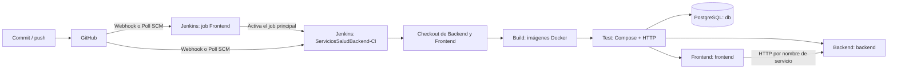

# Entrega: Integración continua con Jenkins

> **Antes de entregar:** completen los integrantes y la conclusión con los datos y la reflexión propios del equipo. Las capturas deben ser de ejecuciones reales de su instancia Jenkins.

## Integrantes y repositorios

- **Integrantes:** [nombres completos y códigos]
- **Repositorio Backend:** <https://github.com/Brainlaer/ServiciosSaludBackend>
- **Repositorio Frontend:** <https://github.com/Brainlaer/ServiciosSaludFrontend>
- **Rama de integración:** `main`

## Arquitectura y flujo



El job `ServiciosSaludBackend-CI` es el pipeline principal y su [Jenkinsfile](Jenkinsfile) contiene las etapas `Checkout`, `Build` y `Test`, además de `post`. El Jenkinsfile del repositorio Frontend activa el job principal cuando hay cambios en ese repositorio. La prueba levanta una base PostgreSQL temporal junto con los dos servicios y valida la comunicación Frontend → Backend usando el nombre DNS `backend` de Docker Compose. También comprueba la página del frontend y su proxy `/api`.

## Requisitos para ejecutar Jenkins

### Hardware recomendado

- Equipo Linux dedicado o máquina virtual con al menos **2 CPU**, **4 GB de RAM** y **20 GB de disco**.
- Conexión a Internet para descargar Jenkins, plugins, dependencias e imágenes.
- Si se usa Docker dentro del contenedor Jenkins, reservar memoria y disco adicionales para construir las imágenes.

### Software

- Docker Engine y Docker Compose V2 en el host.
- Git.
- Un repositorio GitHub accesible por HTTPS.
- Jenkins LTS (incluye su propio Java); no es necesario instalar Java en el host para el controlador.
- Un agente Jenkins con Docker CLI, Compose V2 y acceso al daemon Docker para ejecutar este pipeline. La configuración de abajo usa un solo contenedor Jenkins como controlador y agente de prácticas.

### Instalación sugerida

El contenedor oficial evita instalar Jenkins y Java manualmente en el host. La imagen derivada instala Docker CLI y Compose V2, requeridos por el pipeline. El volumen nombrado mantiene la configuración, plugins, jobs e historial aunque se reemplace el contenedor.

Desde la carpeta del repositorio Backend, obtener el GID del socket Docker y construir/iniciar Jenkins:

```bash
export DOCKER_GID="$(stat -c '%g' /var/run/docker.sock)"
docker compose -f jenkins/docker-compose.yml up -d --build
```

Abrir `http://localhost:8080`. Para recuperar la contraseña inicial:

```bash
docker exec serviciosalud-jenkins cat /var/jenkins_home/secrets/initialAdminPassword
```

Completar el asistente de inicio y crear el usuario administrador. El volumen `jenkins_home` se conserva al detener el servicio; no ejecutar `docker compose down -v` salvo que se quiera borrar Jenkins y todos sus datos.

**Puertos:** `8080/tcp` para la interfaz web y los webhooks. El puerto `50000/tcp` solo se necesita si se configuran agentes inbound; no se publica en esta instalación. El pipeline no publica los puertos de la aplicación durante las pruebas.

**Nota de seguridad:** montar `/var/run/docker.sock` permite que Jenkins controle el daemon Docker del host y equivale en la práctica a privilegios elevados sobre ese host. Usar una VM dedicada y no exponer Jenkins directamente a Internet sin HTTPS y controles de acceso.

## Plugins y credenciales

En **Manage Jenkins → Plugins**, instalar y reiniciar Jenkins si lo solicita:

- **Git**: checkout de los repositorios.
- **GitHub**: recepción de eventos `push`.
- **Pipeline** y **Pipeline: Declarative**: ejecución de Jenkinsfiles y vista de etapas.
- **Docker Pipeline**: construcción de imágenes con `docker.build`.

Crear credenciales en **Manage Jenkins → Credentials → System → Global credentials**. Los IDs deben coincidir exactamente:

| ID | Tipo | Contenido |
|---|---|---|
| `github-https` | Username with password | Usuario GitHub y un PAT con permiso de lectura de contenido para ambos repositorios privados. Si son públicos, el checkout puede ser anónimo, pero dejar configurada la credencial permite que el mismo pipeline funcione si se hacen privados. |
| `ci-postgres-user` | Secret text | Usuario de la base de datos temporal de CI, distinto de cualquier usuario de producción. |
| `ci-postgres-password` | Secret text | Contraseña temporal de la base de datos de CI. |

El PAT y los valores de base de datos se guardan en Jenkins, no en el código ni en GitHub. Configurar el job Backend con la credencial `github-https` en su definición SCM; el checkout adicional de Frontend usa ese mismo ID.

## Jobs y ejecución automática

Crear dos jobs tipo **Pipeline**, no jobs freestyle:

1. **`ServiciosSaludBackend-CI`**: Pipeline script from SCM; SCM Git, URL del repositorio Backend, rama `*/main`, credencial `github-https` y script path `Jenkinsfile`.
2. **`ServiciosSaludFrontend-CI`**: Pipeline script from SCM; SCM Git, URL del repositorio Frontend, rama `*/main`, credencial `github-https` y script path `Jenkinsfile`.

Guardar cada job y ejecutarlo una vez manualmente para registrar su configuración declarativa de triggers. A partir de ahí, se puede usar webhook y/o Poll SCM:

- En GitHub, crear en **ambos repositorios** un webhook a `https://<dominio-publico-de-jenkins>/github-webhook/`, con tipo de contenido `application/json` y eventos de push. Jenkins debe ser accesible desde GitHub; una dirección `localhost` no sirve para webhooks.
- Los dos Jenkinsfiles también declaran `pollSCM('H/5 * * * *')` como alternativa. El job Frontend activa el job Backend; el pipeline principal vuelve a descargar ambos repositorios y construye la versión actual de cada uno.
- Si se cambia el nombre del job principal, actualizar el nombre usado por el Jenkinsfile de Frontend.
- Para webhooks de prueba en una máquina local, usar un túnel HTTPS autorizado y temporal; no compartir públicamente credenciales ni la consola de Jenkins.

## Construcción y prueba

El pipeline construye las imágenes `serviciosalud-backend:<número-de-build>` y `serviciosalud-frontend:<número-de-build>`. El Dockerfile del backend empaqueta la aplicación Spring Boot; el del frontend compila Angular y sirve los archivos con Nginx. Nginx reenvía `/api` al servicio `backend:8082`, y Angular usa una ruta relativa para que la misma configuración funcione detrás del proxy.

En la etapa `Test`, `docker-compose.ci.yml` inicia PostgreSQL, backend y frontend en una red privada temporal. Jenkins solicita el endpoint del backend desde el contenedor frontend usando `http://backend:8082/...`; los fallos de DNS, conexión o respuesta HTTP hacen fallar el build. Luego también comprueba `/` y `/api` a través de Nginx. El bloque `post` recoge logs y elimina los contenedores y volúmenes del proyecto de prueba tanto en éxito como en fallo.

La aplicación local Angular también usa el proxy definido en `proxy.conf.json`; iniciar el backend en `localhost:8082` y el frontend con `npm start`.

## Evidencias para anexar

Guardar capturas propias en el informe final:

1. **Plugins y credenciales:** lista de plugins instalados (sin mostrar valores secretos) y credenciales existentes mostrando solo sus IDs/tipos.
2. **Configuración de jobs:** SCM, rama, script path y webhook configurado en los dos repositorios.
3. **Vista de etapas:** ejecución de `ServiciosSaludBackend-CI` con `Checkout`, `Build`, `Test` y resultado final.
4. **Consola:** salida donde se vean las dos imágenes construidas y el mensaje de prueba de comunicación por nombre de servicio.
5. **Historial:** lista de builds con fecha, número y estado.
6. **Fallo y corrección (opcional recomendado):** si se presenta, usar una rama de pruebas, guardar la captura del build fallido y la del build corregido; no dejar un cambio defectuoso en `main`.

No incluir en las capturas PATs, contraseñas, archivos `.env` ni la contraseña inicial de Jenkins.

## Conclusiones del equipo

> **Borrador para personalizar con la experiencia real antes de entregar:** La integración de Jenkins permitió automatizar la construcción del backend y el frontend cada vez que se actualiza cualquiera de los repositorios. La prueba con Docker Compose verifica además que los servicios se resuelvan por nombre y que la ruta de API responda; esto ayuda a detectar problemas de integración antes de entregar. En nuestra ejecución, [describir un fallo real y cómo se resolvió] y aprendimos que [agregar reflexión propia del equipo].

## Referencias

Docker, Inc. (s. f.). *Docker Compose*. https://docs.docker.com/compose/

GitHub. (s. f.). *Creating webhooks*. GitHub Docs. https://docs.github.com/en/webhooks/using-webhooks/creating-webhooks

Jenkins. (s. f.). *Pipeline*. Jenkins User Documentation. https://www.jenkins.io/doc/book/pipeline/

Jenkins. (s. f.). *Using Docker with Pipeline*. Jenkins User Documentation. https://www.jenkins.io/doc/book/pipeline/docker/

Jenkins. (s. f.). *Installing Jenkins with Docker*. Jenkins User Documentation. https://www.jenkins.io/doc/book/installing/docker/
